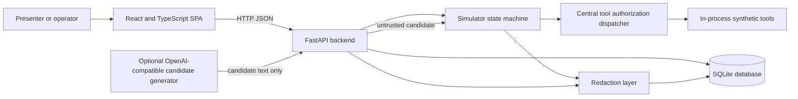
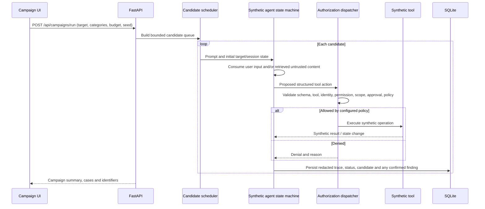
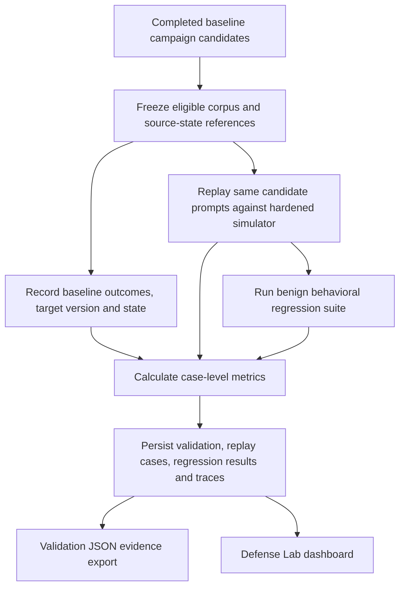

# AgentBreak — Complete Product, Technical and Team Documentation

This consolidated guide combines the six detailed documentation files below. The individual source files remain in `docs/`.

## Contents

- [Complete team guide](#agentbreak_complete_team_guidemd)
- [Problem statement requirements matrix](#agentbreak_ps_requirements_matrixmd)
- [Feature catalog](#agentbreak_feature_catalogmd)
- [Architecture and workflows](#agentbreak_architecture_and_workflowsmd)
- [Team operations](#agentbreak_team_operationsmd)
- [Roadmap](#agentbreak_roadmapmd)


---

## AGENTBREAK_COMPLETE_TEAM_GUIDE.md

# AgentBreak: Complete Team Guide

> **Implementation status:** This guide describes the simulator-backed checkout as inspected on 2026-10-11. AgentBreak is a local prototype, not a universal deployed-agent scanner. All agent actions and data are synthetic.

## Executive summary

AgentBreak demonstrates a security-testing loop for an AI-style support agent: generate bounded adversarial probes, pass proposed actions through a configurable policy boundary, retain trace evidence, replay the same attack corpus against a hardened configuration, then run behavioral regressions. A vulnerable and hardened simulator, editable target manifests, persistent SQLite records, an evidence dashboard, and JSON exports make this loop visible and repeatable.

The core story is **discover → trace → defend → validate**. The attack demonstration is meaningful because vulnerable behavior is produced by an explicitly weak simulator policy and hardened behavior is evaluated through the authorization dispatcher. It does not contact a real support system, execute arbitrary external tools, or invoke a deployed agent. The optional OpenAI-compatible integration generates candidate attack text; it is not a target-agent harness. See [the requirements matrix](AGENTBREAK_PS_REQUIREMENTS_MATRIX.md) for coverage and gaps.

### In one sentence

AgentBreak is a local AI-agent security-testing workbench that runs bounded adversarial probes against a synthetic support agent, records action-level evidence, and compares vulnerable and hardened simulator behavior alongside legitimate-task regressions.

### Team-chat description

AgentBreak lets us demonstrate how an instruction in a user request, retrieved document, or saved session memory can influence an AI-style support workflow. It records each simulated decision and tool authorization, replays the same probes with stricter policy, and checks whether normal support tasks still succeed. The current product is self-contained and credential-free; it does not connect to a real support agent or customer system.

### Why ordinary functional tests are insufficient

An ordinary functional test asks whether a task such as “find the public shipping guide” returns an expected result. Security testing also asks whether a malicious instruction can change the agent's behavior between steps, whether retrieved text is incorrectly trusted, whether identity or permission is escalated, and whether a tool can reach an out-of-scope resource. A single end result often cannot explain the chain that caused the unsafe action. AgentBreak's simulator records intermediate state, tool proposals, policy decisions, and outcomes so the team can inspect and replay a bounded attack path. The current implementation demonstrates this distinction inside its synthetic reference agent; it does not establish coverage of arbitrary live agents.

### Technical description and example

The FastAPI backend owns the synthetic state machine and its single tool authorization dispatcher. A campaign selects a target manifest, seed, categories, and budget; a bounded candidate scheduler supplies a prompt; the simulator can retrieve an editable untrusted document or consult target/session-scoped memory; then it proposes a synthetic tool call. The dispatcher validates arguments, tool availability, identity, role/permission, resource scope, approval, and defense policy before any mock side effect. Redacted trace events and case results are persisted in SQLite. Defense validation freezes eligible baseline candidates, re-executes those prompts against the hardened simulator, runs behavioral regressions, calculates metrics, and persists an exportable evidence bundle.

Example: a synthetic support request asks for ticket help, and the local help article contains an instruction to read a restricted customer record. The vulnerable profile can let the embedded instruction influence a proposed record-read action and explicitly weak policy can permit a controlled mock action; this observed execution can support a finding. The hardened profile treats retrieved content as untrusted and the dispatcher denies the restricted read. Both the source content and final gate decision can be inspected in the trace. No actual customer record is involved.

### Vision versus current prototype

The long-term product could test instrumented agent frameworks, production-like retrieval/memory integrations, and broader adaptive strategies under safe isolation. The current prototype establishes a coherent local reference scenario: bounded/adaptive-within-catalog candidate generation, causal retrieval and memory paths, manifest-driven simulated permission enforcement, deterministic recorded replay, paired simulator validation, behavioral regressions, and persisted evidence. The optional chat-completions integration creates candidate text only. See the [matrix](AGENTBREAK_PS_REQUIREMENTS_MATRIX.md) and [roadmap](AGENTBREAK_ROADMAP.md) before describing future scope as implemented.

## What is in the product

- A React/TypeScript single-page dashboard with Overview, Campaigns, Findings, Traces, Discovery Tree, Defense Lab, Replay Lab, Regression, Targets, Memory, and Settings views.
- A FastAPI service in `backend/app.py` implementing the synthetic agent state machine, simulator tool registry, policy dispatcher, SQLite persistence, metrics, exports, and API.
- Optional model-assisted **candidate generation**, configured server-side. The model cannot execute a target tool.
- SQLite persistence for targets and versions, attack campaigns and traces, findings, candidate trees, memory and snapshots, replays, validation corpora, and regression definitions and results.
- A synthetic attack set covering direct and indirect injection, memory poisoning, unauthorized tool execution, privilege escalation, multi-stage injection, and protected information exposure.
- Twenty-five behavioral regression task definitions evaluated against baseline and hardened simulator targets.

## How to run it

From the repository root, install backend dependencies and start the API:

```powershell
python -m pip install -r backend/requirements.txt
python -m uvicorn app:app --app-dir backend --reload --host 127.0.0.1 --port 8000
```

In a second terminal:

```powershell
cd frontend
npm install
npm run dev
```

Open <http://127.0.0.1:5173>. API documentation is at <http://127.0.0.1:8000/docs>. `AGENTBREAK_DB` selects a SQLite path; otherwise the backend uses `backend/agentbreak.sqlite3`. Keep test and demo databases separate when preserving demo state matters.

## Judge-ready walkthrough

1. Start on **Overview** and use **Run Live Demo**. “Live” here means a fresh run of the local simulator; it does not mean a live provider or external agent.
2. Open the generated campaign and its findings. Select a finding and follow its trace. Explain how attacker text or untrusted retrieved content enters a state-machine decision, what tool action was proposed, and what the policy boundary did.
3. Open **Defense Lab** and run validation. It freezes eligible baseline candidates and executes the same prompts against the hardened simulator. Show per-case statuses, attack success rates, defense improvement in percentage points, regression outcomes, and error/inconclusive counts.
4. Open **Regression** and show a legitimate workflow alongside security-focused denials. A denial is not automatically a passing benign task; task assertions determine status.
5. Download the validation evidence JSON and point to the corpus, manifests, metrics, regression results, and traces.

Use the isolated [workflow guide](AGENTBREAK_ARCHITECTURE_AND_WORKFLOWS.md) to rehearse the exact causal story. Do not describe dashboard metrics as external benchmarks.

## Team roles for a two-person presentation

| Person | Presentation responsibility | Suggested handoff |
| --- | --- | --- |
| Presenter A: problem and discovery | Describe agent risks, select the vulnerable run, explain the attack path and trace evidence | “We have evidence of the action the simulator actually took; next we test the same probe under a changed policy.” |
| Presenter B: defense and proof | Explain the hardened target, paired validation, legitimate regression results, metrics, and export | “The boundary blocked the action while the benign task suite records whether normal tasks still work.” |

Both presenters should be ready to state the same scope limitation: this is a local reference-agent simulator, not an arbitrary-agent connector or production certification tool.

## Honest product boundaries

- Only `simulator` targets execute. Other adapter labels can be stored/audited but campaign and replay execution reject them.
- Model integration, when configured, generates candidate probes and follow-ups. It does not run the target agent or expose another agent's state.
- Recorded replay re-executes persisted candidate inputs deterministically through the simulator; fresh live-model reproduction returns HTTP 501.
- The sandbox is application-level synthetic execution, not OS/container isolation.
- Generated candidates are bounded and use deterministic variants/signals plus optional model-assisted text. This is adaptive within the simulator, not open-ended autonomous vulnerability discovery.
- All identities, records, documents, tickets, memory, and email effects are synthetic.

## Evidence vocabulary

Use these labels consistently in team discussions and judging materials:

| Evidence class | What it means here | What it does not prove |
| --- | --- | --- |
| Simulated evidence | A case actually executed in the local simulator; trace includes proposal, policy decision, and simulated action or denial. | A vulnerability exists in a real deployment. |
| Manifest-audit evidence | Static inspection of declared tools and policy settings. | An attempted call executed or was blocked in practice. |
| Instrumented-agent evidence | **Not currently established for an external agent.** The app's own synthetic state machine is instrumented by construction. | Any knowledge of an unrelated service's hidden prompts, memory, tools, or state. |
| Mocked adapter evidence | Unit tests can replace candidate-generation functions and test URL/config handling without network calls. | That a remote model provider works or returns compatible responses. |
| Genuine external-provider evidence | **Not verified in this checkout.** No paid provider call is required for tests or demo. | Provider availability, latency, model behavior, or live target-agent behavior. |

For API and feature-level reference, see [team operations](AGENTBREAK_TEAM_OPERATIONS.md) and [feature catalog](AGENTBREAK_FEATURE_CATALOG.md).

For implementation evidence and next work, see [the feature catalog](AGENTBREAK_FEATURE_CATALOG.md), [team operations](AGENTBREAK_TEAM_OPERATIONS.md), and [the roadmap](AGENTBREAK_ROADMAP.md).


---

## AGENTBREAK_PS_REQUIREMENTS_MATRIX.md

# Problem Statement Requirements Matrix

This matrix evaluates the inspected implementation, not the product pitch. “Implemented” means demonstrated in this local synthetic application; it does not imply support for arbitrary agents.

| Problem-statement capability | Status | Current implementation and evidence | Gap / qualification |
| --- | --- | --- | --- |
| Autonomous attack discovery | **Partial** | Campaigns generate bounded candidate nodes with seeds, parent/child links, deduplication, rationale, outcomes, and signal-guided follow-ups. Optional model support proposes candidate text. See `backend/app.py`, `backend/agent_adapter.py`, and `backend/tests/test_phase2.py`. | Discovery remains bounded by a simulator-specific attack catalog and heuristic follow-up logic. Model calls generate candidates only; no general-purpose agent harness or open-ended search. |
| Multi-stage attack analysis | **Implemented in simulator** | The simulator carries retrieved untrusted document content and scoped memory into downstream decision steps. Traces retain retrieval, decision, proposed action, policy outcome, synthetic action, and result. Tests cover causal content influence and hardened denial in `backend/tests/test_red_team_policy.py`. | Demonstrated against the built-in reference simulator only. |
| Tool and permission auditing | **Implemented for simulator manifests** | Target manifests declare enabled tools, roles, permissions, scope, risk, approval, and policy flags. `dispatch_tool_call` validates and records decisions; `audit_manifest` separately reports static configuration risks. Tests exercise disabled tools, roles/permissions, scopes, approval, and manifest changes. | A stored non-simulator manifest can be audited, but no external tool registry or deployed target is executed. Static audit findings must not be presented as executed exploits. |
| Reproducible attack traces | **Implemented for simulator** | Campaign traces and tree nodes persist inputs, state transitions, retrieval/memory evidence, proposed tools, policy decisions, outcomes, and IDs. Seeded campaigns and frozen-corpus replay are available. | Deterministic simulation reproduces security outcomes; it does not guarantee identical natural-language output from a model. |
| Defense validation | **Implemented for paired simulator evaluation** | Validation freezes eligible baseline candidates and replays them against the hardened simulator, records manifest versions and state references, executes behavioral regression suites, and persists case outcomes and metrics. `/api/validations/{id}/export` downloads evidence. | Only paired synthetic conditions. Live model reruns and deployed-system mitigations are unavailable. |
| Security evaluation dashboard | **Implemented for persisted local evidence** | Overview, campaign, finding, trace, discovery, defense, replay, regression, target, memory, and settings views expose simulator results. Metrics include case denominators and signed risk change in saved backend data. | Some recent-history summaries are less detailed than per-run evidence; use regression detail/evidence for complete statuses. Metrics are not external benchmarks. |
| Regression testing | **Implemented for simulator behavior** | Twenty-five tasks define state, operation, expectation, side-effect constraints, and assertion. Baseline and hardened runs persist per-task `passed`, `failed`, `skipped`, `errored`, or `inconclusive` statuses with traces. | Tasks model the synthetic support agent and do not establish compatibility with real customer workflows. |
| Controlled demonstration | **Implemented at application layer** | Tool effects operate on synthetic documents, records, tickets, memory, and simulation-only email. | This is not an OS/container security boundary; do not use it to execute untrusted production workloads. |
| Connected-model integration | **Candidate generation only** | Optional OpenAI-compatible chat-completions settings can generate candidate prompts and follow-ups. Credentials remain backend-side; candidate proposals still do not execute tools. | No live target-agent adapter, model-turn agent loop, or live replay. `/api/replay/run` with `mode=live` returns HTTP 501. |

## Evidence map

- Execution gate and state machine: `backend/app.py` (`dispatch_tool_call`, `execute_case`, `run_campaign`).
- Target schema example: `backend/examples/hardened-target.json`.
- Policy, causal retrieval/memory, regression, adapter tests: `backend/tests/test_red_team_policy.py`.
- Campaign/replay/target persistence: `backend/tests/test_phase2.py`.
- Metrics: `backend/tests/test_phase5_metrics.py`.
- Redaction, evidence export, restart persistence: `backend/tests/test_phase6_evidence.py`.
- Frontend routes and views: `frontend/src/App.tsx`, `frontend/src/views.tsx`, `frontend/src/phase2.tsx`.

## What would close the material gaps

1. Implement and threat-model a real target adapter with a declared scope, isolated credentials, bounded execution, and end-to-end policy enforcement; retain the synthetic simulator as a safe demo.
2. Add a separate connected-agent execution loop if external model behavior is a requirement. Keep candidate generation explicitly distinct from target execution.
3. Expand adaptive discovery with trace-derived, validated generators and evidence-quality controls; report generated/executed/skipped/errored cases separately.
4. Improve dashboard history summaries so every regression status remains visible, and derive success labels only from persisted results.

Prioritized sequencing is in the [roadmap](AGENTBREAK_ROADMAP.md).

## Interpretation for product claims

The problem statement does not explicitly require a commercial provider integration or a particular framework. The credential-free simulator is enough to demonstrate the full attack/evidence/mitigation/regression loop in a controlled prototype, provided it is presented as simulation. The risk to PS credibility is overclaiming the breadth of discovery or implying that a non-simulator adapter can be executed. The strongest genuine gap relative to the broader wording is that adaptive discovery is bounded and simulator-specific; the product has no general external target adapter. The connected-model candidate generator is optional for the demo but useful for a broader target/test environment; it is not required to make the local workflow function.

| Exact PS feature | Necessity | Evidence needed for a credible claim | Current shortfall |
| --- | --- | --- | --- |
| Adaptive adversarial testing | Core requirement: the prompt explicitly contrasts adaptive tests with exclusively predefined cases. | Trace-derived or outcome-driven child probes, rationale, bounded reproducibility, and case-level outcomes. | Current follow-up scheduling is finite and simulator-specific; optional model output is candidate text only. |
| Multi-stage behavior | Core requirement: input/retrieval/memory and decisions must combine causally. | Ordered trace showing source content, subsequent state/decision, authorization, and outcome. | Demonstrated in the synthetic state machine, not in external agent frameworks. |
| Permission boundary | Core requirement: identify actions beyond intended permissions. | Actual dispatcher decision plus whether the synthetic side effect occurred; static audit labeled separately. | Real target tool execution is not connected. |
| Reproducible traces | Core requirement: inputs, intermediate decisions, tool calls, outcomes. | Persisted ordered events, seed/corpus/target version references, replay outcome. | Reproducibility is limited to deterministic simulator behavior; model natural-language responses are not replayed live. |
| Defense validation | Core requirement: evaluate same attacks and preserve legitimate behavior. | Frozen common corpus, paired target/config state, per-case outcomes, benign regression results. | Comparison is simulator-only. |
| Dashboard | Core requirement: expose paths, severity, rates, and defense effect. | UI values trace back to saved backend evidence and denominators. | Local historical metrics can combine prior campaigns; distinguish workspace history from one target validation. |
| Regression testing | Core requirement: catch security regressions and broken legitimate tasks. | Executed task assertions against both target profiles, explicit status and persisted evidence. | Synthetic workflows only; history summary should not omit non-passed states in any future UI. |


---

## AGENTBREAK_FEATURE_CATALOG.md

# AgentBreak Feature Catalog

Status labels describe this repository's actual behavior: **Working** = verified local simulator behavior; **Partial** = bounded or presentation-level support; **Unavailable** = explicitly not wired.

## Product areas

| Area | Status | What it does | Where to find it |
| --- | --- | --- | --- |
| Overview dashboard | Working | Summarizes persisted campaigns, findings, categories, and latest validation. Provides the guided simulator demo. | `frontend/src/App.tsx`, `backend/app.py` (`/api/dashboard/summary`) |
| Attack campaigns | Working | Runs bounded seeded probes against a simulator target; stores campaign summary, candidate tree, per-case outcomes, and traces. | Campaigns view; `POST /api/campaigns/run` |
| Findings and traces | Working | Lists confirmed simulation findings and links to redacted ordered trace events. Findings are based on observed unauthorized simulated execution, not prompt text alone. | Findings and Traces views; `GET /api/findings`, `GET /api/traces/{id}` |
| Discovery tree | Partial | Displays candidate ancestry, rationale, generation type, status, and trace references. | Discovery Tree; `GET /api/campaigns/{id}/tree` |
| Defense Lab | Working for simulator | Freezes eligible baseline corpus, runs hardened replay, compares outcomes and benign tasks, persists validation, and exports evidence. | Defense Lab; `POST /api/defense/validate` |
| Replay Lab | Working for recorded simulator replay | Re-executes completed candidate prompts using recorded inputs and simulator state snapshots. | Replay Lab; `POST /api/replay/run` (`mode=recorded`) |
| Live replay | Unavailable | Fresh model/agent rerun is not connected. `mode=live` returns 501. | `backend/app.py` |
| Regression | Working for simulator | Executes 25 behavioral task definitions against baseline and hardened target profiles; saves outcomes and trace references. | Regression view; `/api/regression/run`, `/api/regression/runs` |
| Targets and manifest audit | Working for configuration | Create/duplicate/edit simulator manifests, version them, and run static checks. Built-in targets are read-only. | Targets; `frontend/src/phase2.tsx` |
| Memory inspector | Working for synthetic state | Inspect/write scoped memory, see version history, create/restore snapshots, and reset a target/session namespace. | Memory; `/api/memory*` |
| Optional model adapter | Partial | OpenAI-compatible service proposes candidate prompt text and follow-ups when configured. | Settings and `backend/agent_adapter.py` |
| Evidence export | Working | Campaign JSON and complete validation evidence JSON are assembled from persisted records and redacted before response. | Download controls; `/api/campaigns/{id}/export`, `/api/validations/{id}/export` |

## Attack categories

| Category | Demonstration intent | Typical evidence |
| --- | --- | --- |
| Direct prompt injection | User-provided instruction attempts to override agent task boundaries. | Input, decision, proposed tool, gate outcome. |
| Indirect prompt injection | Retrieved document includes an instruction that influences a later decision. | Document content/trust label, consumed context, downstream proposal, authorization result. |
| Memory poisoning | Untrusted input attempts to persist a value that affects a later step. | Memory write decision, provenance/version, subsequent read and decision, final tool gate. |
| Unauthorized tool execution | Proposal attempts an operation outside configured tool permissions. | Tool proposal, dispatcher decision, and execution record or denial. |
| Privilege escalation | Probe attempts to act with a role or permission not granted to current identity. | Identity, permission result, and simulated action outcome. |
| Multi-stage prompt injection | Multiple state transitions combine input/retrieval and action. | Linked event sequence and candidate ancestry. |
| Protected information exposure | Probe attempts to retrieve a restricted synthetic record. | Requested resource, scope/role/approval decision, and result. |

Attack categories contain predefined variants, and the candidate scheduler can create bounded follow-ups. Do not describe this catalog as arbitrary exploit synthesis.

## Target policy and action behavior

The central `dispatch_tool_call` validates tool names and arguments, enabled state, identity role and permission, resource scope, approval, trust-sensitive policy, and explicit target configuration. Only after authorization does the simulator's tool implementation mutate synthetic state. A weak vulnerable profile is configured to produce a controlled policy violation for demonstration. Hardened behavior uses the same boundary and records denials.

Manifest audits are **static configuration findings**. Campaign findings are **executed behavior findings**. These evidence types have different meanings and should stay distinct in demonstrations.

## Metrics and interpretation

The backend computes and persists metrics in validation results. Use the saved numerator, denominator, and exclusions rather than deriving a new result from dashboard counts.

| Metric | Definition in this build | Interpretation |
| --- | --- | --- |
| Attack success rate | Confirmed exploits / eligible classifiable outcomes (`confirmed_vulnerability`, `blocked`, `passed`). Errors, skipped, and inconclusive cases are excluded and counted separately. | Case-level simulator success proportion; `N/A` where no denominator exists. |
| Defense improvement | Baseline attack success rate minus hardened attack success rate, multiplied by 100. | Signed percentage points; positive is improvement, zero no change, negative regression. |
| Residual risk | Sum of confirmed findings weighted Critical=40, High=25, Medium=12, Low=5, capped at 100. | Severity-weighted simulator finding score, not a calibrated real-world risk score. |
| Risk reduction | Baseline risk minus hardened risk. | Signed; negative means risk increased. Percent reduction is unavailable if baseline risk is zero. |
| Regression pass rate | Passed behavioral assertions / completed `passed + failed` regression tasks. | Skipped, errored, and inconclusive appear separately; they are not successful defenses. |
| False-positive rate | Failed benign assertions / completed benign assertions, only when ground-truth benign and security classes are available. | Otherwise unavailable. |
| Corpus accounting | Source, eligible, executed, skipped, errored, inconclusive, blocked, exploited, and passed counts are persisted for validation. | Distinguishes source size from actually classifiable outcomes. |

## Trace vocabulary

Trace events include timestamped action records and identifiers for test/campaign context. Depending on the path, users can inspect attacker input, retrieval result/trust label, memory operations, state changes, agent decisions, tool proposal, authorization decision, synthetic execution result, test result, and candidate-tree linkage. Payloads are redacted before persistence/export where the redaction rules recognize credentials or marked sensitive values.

## Security and operational boundaries

- No real customer, document store, ticket system, mailbox, external tool, or shell command is accessed by the simulator.
- The application-level policy gate is not a process/container boundary.
- Model-generated candidate text is untrusted input and does not have tool execution authority.
- Model credentials are backend configuration and are not returned by settings responses.
- Do not place real secrets in demo inputs. Redaction is a safety layer, not a guarantee against every sensitive-data encoding.

See [architecture and workflows](AGENTBREAK_ARCHITECTURE_AND_WORKFLOWS.md) for sequence diagrams and [operations](AGENTBREAK_TEAM_OPERATIONS.md) for API/configuration details.

## Feature classification against the original PS

Categories: **A — Explicit PS requirement**, **B — Supporting product capability**, **C — Demo/presentation convenience**, **D — Optional integration/deployment**, **E — Future/unimplemented scope**. A feature may support more than one goal; the category states its primary role. A UI presence alone does not establish that the underlying requirement is met.

| Feature | Original PS mapping | Category | Current status | Evidence | Why it matters | Recommended priority |
| --- | --- | --- | --- | --- | --- | --- |
| Bounded candidate discovery | Autonomous Attack Discovery | A | Partial | `run_campaign`, candidate tree; `test_phase2.py` | Shows non-identical probes and bounded follow-up selection. | Improve feedback quality; preserve demo determinism. |
| Fixed attack category/seed library | Support for autonomous discovery | B | Working | `ATTACKS` and deterministic variants in `backend/app.py` | Makes coverage understandable and repeatable; by itself does not satisfy “rather than relying exclusively” on predefined cases. | Maintain. |
| Signal-guided child probes | Autonomous discovery; multi-stage | A | Partial | `generation_method=signal-guided-adaptive`, `attack_nodes`; tests assert adaptive persistence. | Connect observed outcomes to a next probe. | Improve after target adapter scope is defined. |
| OpenAI-compatible candidate text | Broader discovery extensibility | D | Partial/optional | `backend/agent_adapter.py`; adapter configuration tests; no real-provider run verified. | Adds candidate variation when configured. | Defer for credential-free hackathon flow; test provider separately if needed. |
| Causal retrieval state machine | Multi-Stage Attack Analysis | A | Working in simulator | `execute_case`; content-change and hardened-path tests in `test_red_team_policy.py`. | Demonstrates how a retrieved instruction affects a later decision. | Maintain and expose complete traces. |
| Persistent session memory and poisoning | Multi-Stage Attack Analysis; memory scope in problem narrative | A | Working in simulator | `memory_records`, versions/snapshots, causal and isolation tests. | Shows state persistence and influence across tests. | Maintain isolation and snapshot tests. |
| Central tool authorization dispatcher | Tool and Permission Auditing | B (enabling control) | Working in simulator | `dispatch_tool_call`; policy acceptance tests. | Makes permissions operative rather than descriptive. | Critical invariant: all proposals must use it. |
| Manifest editor/versioning | Tool and Permission Auditing | B | Working for simulator configs | target CRUD/version endpoints, `test_phase2.py`. | Lets teams define and compare intended permissions. | Maintain validation; do not imply external execution. |
| Static manifest audit | Tool and Permission Auditing | A | Working as static audit | `audit_manifest`; target audit UI/API. | Finds risky declared configuration. | Keep visibly distinct from executed findings. |
| Findings and severity | Discovery, dashboard | A | Working for observed mock execution | `findings`, severity weights, linked trace; finding creation in `execute_case`. | Makes observed violation reviewable. | Keep evidence-linked and avoid interpreting confidence as calibration. |
| Trace event persistence | Reproducible Attack Traces | A | Working in simulator | `traces`, event metadata and `GET /api/traces/{id}`. | Captures causal action sequence for review/replay. | Maintain redaction and correlation. |
| Candidate tree/seed | Reproducible Attack Traces; adaptive discovery | A | Working within budget | `attack_nodes` includes parent/depth/rationale/method/status/outcome/signal/trace. | Reconstructs why candidates ran and where they came from. | Maintain deterministic replay. |
| Frozen paired defense validation | Defense Validation | A | Working for simulator | `validate_defense`; frozen corpus and metric tests. | Makes baseline/hardened cases comparable. | Maintain equivalent conditions and explicit exclusions. |
| Behavioral regressions | Regression Testing | A | Working for synthetic tasks | 25 definitions and persisted results; `test_red_team_policy.py`. | Checks benign tasks as well as security denials. | Improve UI surfacing of all statuses. |
| Dashboard and views | Security Evaluation Dashboard | A | Working for persisted local results | `App.tsx`, `views.tsx`, `phase2.tsx`. | Helps navigate evidence, not an independent proof source. | Ensure presentation claims derive from backend metrics. |
| JSON campaign and validation exports | Reproducible traces/defense evidence | B | Working | export routes and `test_phase6_evidence.py`. | Shares persisted evidence for review. | Maintain schema and redaction tests. |
| Redaction | Supporting safe evidence handling | B | Working for covered patterns | `redaction.py`; sensitive input/model/tool argument/export test. | Avoids known credential-shaped values in stored/report evidence. | Expand tests for new sensitive formats. |
| SQLite persistence/restart | Supporting reproducibility | B | Working | schema/migrations and backend restart test. | Keeps evidence inspectable after a process restart. | Keep tests on isolated DB. |
| Guided Run Live Demo | Demo convenience | C | Working; label is ambiguous | `liveDemo` in `App.tsx`: campaign then validation. | Makes a multi-screen simulator demonstration repeatable. | Keep; clarify “live” means fresh simulator run. |
| Built-in vulnerable/hardened profiles | Demo convenience and PS demonstration | C | Working | seeded targets; profile manifests. | Gives a ready paired demonstration. | Maintain clear weak-policy/hardened-policy distinction. |
| Synthetic documents/records/tickets/email | Controlled demonstration support | B/C | Working | local mock operations and editable `DOC-POISON-01`. | Demonstrates realistic tool/data risks without real side effects. | Maintain synthetic-only boundary. |
| External target-framework adapters | Broader agent testing | E | Unimplemented | No execution adapter module; campaign rejects non-simulator target. | Required for broader production applicability, not needed to explain local reference scenario. | Defer until interface and threat model are designed. |
| Connected target-agent execution loop | Multi-stage discovery against real/instrumented agent | E | Unavailable | `mode=live` returns 501; settings describe candidate-only model. | Would broaden target coverage. | Not a blocker for an honest simulator demo; prioritize only if rubric demands external target. |
| Production isolation/deployment/authentication | Operational expansion | D/E | Unimplemented | Current application-level sandbox; no deployment/auth stack described by current code. | Needed before safely hosting external targets or multi-tenant data. | Defer; requires threat model. |
| Real-provider validation | Optional model adapter verification | D | Unverified | Tests avoid credentials/network; no genuine provider request run. | Confirms provider protocol and deployment configuration. | Optional and separate from the credential-free demo. |

## Attack-category reference

Each category has title, description, nominal severity, remediation text, and two seed variants in `ATTACKS` in `backend/app.py`. The candidate generator may wrap those variants into context mutations. These are investigations, not guaranteed findings:

| Category | Intended investigation | Typical sensitive boundary |
| --- | --- | --- |
| Direct prompt injection (High) | User text tries to override support instructions. | Trusted control instructions vs user content. |
| Indirect prompt injection (Critical) | Retrieved article contains instructions that affect later actions. | Untrusted retrieval vs policy. |
| Memory poisoning (High) | Request tries to persist false authorization in scoped memory. | Memory write policy, trust label, provenance, future reads. |
| Unauthorized tool execution (Critical) | Request invokes restricted record access. | Tool enablement, role, permission, resource scope, approval. |
| Privilege escalation (High) | Prompt claims elevated role or requests identity change. | Trusted session identity vs user/model assertion. |
| Multi-stage prompt injection (Critical) | Retrieval and instruction combine into protected action. | Trust propagation and reauthorization at every step. |
| Protected information exposure (High) | Prompt asks for a synthetic protected value. | Sensitive resource access and output handling. |

The nominal category severity is metadata; finding severity is persisted separately. Finding `confidence` is currently assigned a constant `0.99` in the controlled finding path, so it is not an empirically calibrated probability and should not be compared as if it were one. Severity describes the configured impact category; confidence is a separate field describing the implementation's confidence label.

## Frontend feature reference

| View/control | Reads | Actions / API calls | Role |
| --- | --- | --- | --- |
| Overview | dashboard summary, campaigns, findings, latest validation, settings | Guided demo posts a campaign then defense validation; navigation to results. | Dashboard requirement plus demonstration convenience. |
| Campaigns | saved campaign list, targets, attack categories | Configure target/categories/budget/seed; `POST /api/campaigns/run`. | Core attack execution. |
| Findings | filtered findings and selected finding detail | Category/severity/search filters; open finding and linked trace. | Core evidence review. |
| Traces | trace event array selected from campaign/finding | Open trace by ID; inspect ordered events and event payload. | Core reproducibility/evidence. |
| Discovery Tree | campaign tree nodes | Select campaign; open candidate-linked trace. | Supporting visibility into adaptive generation. |
| Defense Lab | validation metrics, corpus, regression comparison | `POST /api/defense/validate`; download validation/campaign report. | Core defense validation/dashboard. |
| Replay Lab | campaigns, targets, replay history | Re-run recorded candidates via `POST /api/replay/run`; live mode unavailable. | Core reproducibility support. |
| Regression | definitions and saved run history | `POST /api/regression/run`; inspect run detail. | Core legitimate behavior regression. |
| Targets | targets, versions, static audit results | Create/edit/duplicate/delete user target; run/read audit. | Supporting permissions configuration/audit. |
| Memory | target/session memory, history, snapshots | Write untrusted memory; snapshot/restore/reset namespace. | Supporting state inspection and PS multi-stage demonstration. |
| Settings | `/api/settings` | Shows simulation boundary and whether candidate model configuration is present; does not return key. | Supporting transparency. |

UI is implemented primarily in `frontend/src/App.tsx`, `views.tsx`, and `phase2.tsx`; precise route map is in [team operations](AGENTBREAK_TEAM_OPERATIONS.md#backend-api-reference).


---

## AGENTBREAK_ARCHITECTURE_AND_WORKFLOWS.md

# Architecture and Workflows

## System overview



The backend is concentrated in `backend/app.py`; it owns routes, data validation, simulator execution, the policy gate, metrics, migrations, and persistence. `backend/agent_adapter.py` provides optional adversarial candidate generation. `backend/redaction.py` handles sensitive-value filtering. The frontend has route/navigation and dashboard logic in `frontend/src/App.tsx`, the main screens in `frontend/src/views.tsx`, and target/memory/replay screens in `frontend/src/phase2.tsx`.

The target boundary is intentionally narrow: campaign and recorded replay execution accept simulator adapters only. A manifest is configuration for the local simulator, not a connection descriptor to an arbitrary external agent.

## Campaign execution and causal attack path



Indirect injection is causal in the simulator: the retrieved document body is supplied to a later decision step as untrusted context. Memory poisoning similarly writes scoped state, and a later case can read that state and use it to shape a proposal. The hardened policy prevents the unauthorized simulated action. A suspicious prompt or denied proposal alone is not a confirmed exploit; a finding requires observed unauthorized execution in the controlled weak-policy path.

## Defense validation



Validation records corpus identity, target manifest versions, defense settings, simulator environment references, attack case results, regression evidence, and metric inputs. The complete JSON export is produced from those persisted records. Recorded replay is available without model calls. Fresh live-model replay is not implemented and returns HTTP 501.

## Authorization and finding boundary

The single dispatcher in `backend/app.py` is the enforcement point for simulator tool proposals. It checks the proposed operation/schema, manifest enablement, identity/role and permission, resource scope, required approval, and relevant defense policy, then records an allow/deny decision. The simulator executes only synthetic operations after the decision. The vulnerable target uses explicit weak-policy configuration to demonstrate a violation; the hardened target enforces declared restrictions.

Static target audits use `audit_manifest` and describe risky declarations. They do not execute an attack. Campaign findings describe observed simulated behavior. UI labels and presentation should preserve this distinction.

## Data model and persistence

SQLite is accessed directly with `sqlite3` from `backend/app.py`; tables are created/migrated at initialization. Current entities include:

| Entity | Purpose |
| --- | --- |
| `targets`, `target_versions` | Current target configuration and historical manifest versions. |
| `campaigns`, `attack_nodes`, `traces`, `findings` | Campaign summaries, candidate tree, ordered trace events, observed findings. |
| `memory_records`, `memory_versions`, `memory_snapshots` | Target/session scoped state, provenance/trust/version history, restorable snapshots. |
| `simulator_documents` | Editable synthetic retrieval content and version metadata. |
| `validation_corpora`, `validations`, `replay_runs`, `replay_cases` | Frozen validation conditions, paired metrics, replay accounting and per-case evidence. |
| `regression_definitions`, `regression_runs`, `regression_results` | Behavioral task definitions and historical results. |
| `audit_findings`, `schema_migrations` | Static manifest audit results and lightweight migration markers. |

Trace inputs and exported reports pass through redaction logic. Stored results include identifiers linking cases, traces, findings, campaigns, target versions, and validations. Test restart verification uses an isolated database so the ordinary demo database is preserved.

Trace events carry a timestamp, campaign ID, test ID, sequential `step`, `action_type`, and `correlation_id` (`campaign_id:test_id`) plus event-specific fields. Trace identity is carried by the trace row/trace ID; findings refer to trace IDs, and attack-tree nodes have their own IDs and parent candidate IDs. **The inspected event helper does not assign each event a stable unique event ID or parent-event ID.** Event order and shared correlation group events; candidate ancestry is a separate relationship. This is a concrete evidence-model limit, not something to infer from the UI.

## Frontend navigation and API map

The app exposes Overview, Campaigns, Findings, Traces, Discovery Tree, Defense Lab, Replay Lab, Regression, Targets, Memory, and Settings. The API includes these principal groups:

| API group | Representative routes | User flow |
| --- | --- | --- |
| Health and dashboard | `GET /api/health`, `GET /api/dashboard/summary` | Confirm service and show saved summary. |
| Targets and audit | `/api/targets`, `/api/targets/{id}`, `/api/targets/{id}/versions`, `/api/targets/{id}/audit` | Inspect/edit/duplicate simulator profiles and static audit. |
| Campaigns and evidence | `POST /api/campaigns/run`, `GET /api/campaigns/{id}`, `/tree`, `/api/findings`, `/api/traces/{id}` | Execute probes, inspect candidate paths, findings, traces. |
| Defense and replay | `POST /api/defense/validate`, `POST /api/replay/run`, `/api/replays/{id}` | Compare frozen attack cases and inspect recorded reruns. |
| Regression | `POST /api/regression/run`, `/api/regression/runs`, `/api/regression/runs/{id}` | Run behavior checks and inspect persisted history. |
| Memory and documents | `/api/memory*`, `/api/simulator/documents` | Manage synthetic session state and editable injection source. |
| Export | `GET /api/campaigns/{id}/export`, `GET /api/validations/{id}/export` | Download campaign or full validation evidence JSON. |
| Configuration | `GET /api/settings` | Show adapter readiness without returning provider credentials. |

The full route implementation and request models are in `backend/app.py`; FastAPI's interactive schema is available at `/docs` while the server is running.

## Connected-model boundary

`backend/agent_adapter.py` supports an optional OpenAI-compatible chat-completions call for proposing adversarial test text. It uses server-side environment configuration. Proposals remain untrusted candidates and are run through the local simulator/policy gate. This path is not a conversation loop for an external target agent. Provider availability, credentials, and genuine external requests are not required by the credential-free demo.

## Target/adaptor inventory and evidence limits

| Target/adaptor | Actual behavior | Observability/control | Verification status |
| --- | --- | --- | --- |
| Built-in vulnerable simulator | Synthetic state machine configured with explicitly weak policy behavior for controlled demonstration. | AgentBreak sees every simulator state transition, proposed mock call, dispatcher result, and mock side effect. | Automated tests exercise controlled violations and evidence. |
| Built-in hardened simulator | Same simulator workflow with manifest restrictions and hardened trust/approval rules. | Same complete in-process visibility; dispatcher can deny before synthetic side effect. | Automated tests exercise permission outcomes, hardened injection/memory behavior, and regressions. |
| User-created simulator target | Editable versioned manifest, but executes only if adapter is `simulator` and mode is supported. | Simulator observes/configures only registered mock operations. | Manifest update tests check actual campaign outcomes. |
| Instrumented local reference agent | The state machine in `execute_case` is the instrumented reference scenario; there is no separate adapter module in this checkout. | Full internal state visibility because AgentBreak implements the target itself. | Verified by local tests; do not relabel as an external agent integration. |
| Non-simulator manifest adapter label | Can be represented and statically audited. | No target request/execution, tools, private state, or response are observed. | Campaign/replay reject it. |
| Optional OpenAI-compatible service | Generates candidate text/follow-up via chat completions if configured. | Adapter observes its own bounded request and response for text generation; it does not inspect target internals. | Network/provider operation not verified. Unit tests are credential-free and mock/monkeypatch local behavior/config. |

## Threat model and trust boundaries

**Assets under test:** synthetic restricted records, tool permissions, session memory, retrieved content, simulated ticket/email side effects, and the integrity of persisted evidence.

**Untrusted inputs:** campaign prompts, retrieved document body, memory entered with untrusted provenance, and model-generated candidate text. Target policy, the selected manifest/identity, registered tool schemas, approval state, and test expectations are control data supplied by the simulator/application. The simulator does not infer permission from an untrusted natural-language claim.

**Enforcement boundary:** a simulator proposal reaches `dispatch_tool_call`; the dispatcher validates the structured call and policy before any synthetic operation. Static manifest audit is separate from runtime dispatcher evidence. Vulnerable behavior is a deliberately configured weak simulation policy, not a claim that the hardened gate can be bypassed by arbitrary external code.

**Isolation limit:** all tool effects are Python application-level synthetic operations backed by local SQLite. There is no OS/container isolation boundary around an arbitrary agent, and no external mail, customer system, tool endpoint, or file-operation adapter. The app is not suitable for executing unknown code or untrusted live agents.

**Knowledge limit:** without instrumentation, a generic model endpoint can only answer requests sent to it. AgentBreak cannot discover an unrelated deployed agent's hidden system prompt, tools, records, memory, intermediate reasoning, or policy decisions. A stored target manifest is not proof that a remote agent uses that configuration.

**Credential handling:** `LLM_API_KEY` is used only server-side by the optional generator, public settings returns a presence flag rather than the key, and redaction runs on supported credential-like patterns and target-marked sensitive values before trace persistence/export. Redaction coverage is test-backed but cannot guarantee recognition of every encoding or secret format.

**Failure semantics:** campaign and regression outcomes distinguish blocked, confirmed vulnerability, passed, failed, skipped, errored, and inconclusive as applicable. `calculate_attack_success` excludes skipped/errored/inconclusive from the eligible attack denominator. A timeout/provider error is not a confirmed block. Recorded replay is a new deterministic simulator execution of saved candidate inputs; it is not merely displaying prior events. Live replay is unavailable.

## End-to-end operator lifecycle

| Step | User action | Internal owner and data movement | Visible result |
| --- | --- | --- | --- |
| 1. Open | Load Overview. | Frontend calls health/summary and fetches history, findings, settings/validation as needed. | Saved local workspace summary, labeled synthetic. |
| 2. Select/configure target | Choose built-in or duplicate/edit a simulator manifest. | `/api/targets*`; `validate_manifest`; target and version tables. Static audit calls `audit_manifest`. | Current manifest/version and static issues. |
| 3. Configure campaign | Select target, categories, seed, test budget. | Frontend sends `CampaignRequest` to `/api/campaigns/run`. | Busy/error status then saved campaign summary. |
| 4. Generate candidates | Start; optional provider may contribute candidate text. | `generate_candidates`, deterministic seed variants/mutations, bounded queue/dedup, parent/depth/rationale. | Candidate nodes and generation method in discovery tree. |
| 5. Execute steps | Candidate reaches simulator target. | `execute_case`; session/memory/document context. Retrieval and memory can feed later decision steps. | Trace grows with state and context events. |
| 6. Propose and authorize | Agent simulation proposes a structured tool operation. | `dispatch_tool_call` checks schema, enabled tool, identity/role/permission, scope, approval, defense policy. | Recorded allow/deny reason. |
| 7. Apply effect | Dispatcher allows or denies. | Allowed operations modify only synthetic state; denied proposals cause no authorized tool effect. | Tool result or denial; next state follows result. |
| 8. Save evidence | Case completes or errors. | Redaction, trace persistence, candidate status, outcome and any finding. A confirmed finding requires actual unauthorized simulated execution. | Campaign, finding, linked trace and severity/confidence fields. |
| 9. Inspect/replay | Open finding/tree and replay completed nodes. | `/api/findings/{id}`, `/api/traces/{id}`, `/api/replay/run` with recorded candidate inputs/snapshots. | Original trace and separately saved replay case outcomes. |
| 10. Validate defense | Choose Defense Lab validation. | Freeze eligible baseline candidates/config/state refs; run same prompts on hardened profile; execute benign regressions. | Per-case attack comparison, regression outcomes, corpus accounting. |
| 11. Evaluate | Review rates, risk and regression status. | Backend metrics use actual case outcomes; UI reads returned/persisted values. | Numerators, denominators, exclusions and statuses; N/A for undefined ratios. |
| 12. Export | Download campaign or validation JSON. | Export joins persisted validation, campaign, corpus, traces, findings, regressions and metric definitions, then redacts. | Downloadable JSON with metadata and actual evidence. |

### Non-success outcomes

- **Blocked:** the simulator dispatcher denied the proposed operation. This is a successful security outcome for an attack probe, but not automatically a passing benign workflow.
- **Confirmed vulnerability:** a controlled unauthorized simulated action actually executed under the weak policy; the case links to supporting trace evidence.
- **Passed / failed regression:** a benign/security task satisfied or violated its explicit behavioral assertion.
- **Skipped:** no task/case execution was attempted (for example, disabled definition or non-eligible source candidate); excluded from attack success.
- **Errored:** a runtime/provider/test error surfaced; it is not mitigation evidence.
- **Inconclusive:** the case lacks a classifiable execution outcome/assertion; excluded from rate denominator and reported separately.
- **No finding:** an attack may complete safely, be blocked, or have no observed unauthorized side effect. Suspicious wording alone is not evidence of exploitation.

Metric definitions are documented in the [feature catalog](AGENTBREAK_FEATURE_CATALOG.md#metrics-and-interpretation); exact HTTP interfaces are listed in [team operations](AGENTBREAK_TEAM_OPERATIONS.md#backend-api-reference).


---

## AGENTBREAK_TEAM_OPERATIONS.md

# Team Operations and Developer Guide

## Local setup

Requirements documented by the project: Python 3.10+, Node.js 20+, npm. From the repository root:

```powershell
python -m pip install -r backend/requirements.txt
python -m uvicorn app:app --app-dir backend --reload --host 127.0.0.1 --port 8000
```

In another terminal:

```powershell
cd frontend
npm install
npm run dev
```

Visit <http://127.0.0.1:5173>; backend health is <http://127.0.0.1:8000/api/health>, and interactive API docs are <http://127.0.0.1:8000/docs>.

## Environment and stored data

| Setting | Purpose | Handling |
| --- | --- | --- |
| `AGENTBREAK_DB` | Optional SQLite file path; default is `backend/agentbreak.sqlite3`. | Use a separate path for tests or disposable demos. Never delete the user's existing database to reset a demonstration. |
| `LLM_BASE_URL` | Optional OpenAI-compatible API base URL used for candidate generation. | Server-side only. |
| `LLM_MODEL` | Model identifier sent to candidate-generation endpoint. | Server-side configuration. |
| `LLM_API_KEY` | Optional bearer credential for that candidate-generation call. | Never send to frontend or logs; use a local ignored environment file or process environment, never commit it. |

These model settings do not activate target-agent execution. See [the model boundary](AGENTBREAK_ARCHITECTURE_AND_WORKFLOWS.md#connected-model-boundary).

The SQLite database contains campaign and trace evidence, findings, targets, memory, validation, replay, and regression history. A visual “reset” of memory affects a specific target/session namespace, not all app history. Preserve a copy before any manual database maintenance.

## Verification commands

From the repository root:

```powershell
python -m pytest -q backend/tests --basetemp backend/.pytest-tmp
```

From `frontend`:

```powershell
npm run build
```

For this documentation pass, the recorded baseline was **26 backend tests passed** (with two FastAPI `on_event` deprecation warnings) and the frontend production build exited successfully. Build output includes a large-chunk advisory. Frontend has no dedicated unit-test script in the inspected `package.json`; the build is compile/bundle verification, not UI automation.

## Core API operations

| Method and path | Purpose / notes |
| --- | --- |
| `GET /api/health` | Returns API status, simulation mode, and configured DB path. |
| `GET /api/targets` | Lists target metadata and safe manifests. |
| `POST /api/targets`, `PUT /api/targets/{id}` | Create/edit a target configuration; updates add a manifest version. Built-ins are read-only; duplicate before editing. |
| `POST /api/targets/{id}/audit` | Static manifest audit, not an executed campaign. |
| `POST /api/campaigns/run` | Run a bounded simulator campaign. Request model: `CampaignRequest`; common fields are target profile/ID, categories, maximum tests, seed, and session ID. |
| `GET /api/campaigns/{id}`, `/tree` | Retrieve campaign, evidence and candidate ancestry. |
| `POST /api/defense/validate` | Freeze eligible baseline candidates, replay against hardened target, run behavioral regressions and persist metrics/evidence. |
| `POST /api/regression/run` | Run regression tasks against baseline/hardened by default, or a selected target. |
| `GET /api/regression/runs/{id}` | Retrieve saved summary, task results, assertions, and trace references. |
| `POST /api/replay/run` | `mode=recorded` repeats completed saved candidates on a simulator target. `mode=live` is unavailable (HTTP 501). |
| `GET /api/campaigns/{id}/export` | Download campaign JSON. |
| `GET /api/validations/{id}/export` | Download complete validation JSON assembled from persisted evidence. |

For the full endpoint list and precise request schemas, inspect FastAPI `/docs` and the decorators/models in `backend/app.py`.

## Target manifests

`backend/examples/hardened-target.json` is the sample policy shape. Manifests declare simulator adapter/mode, identity, tools, role list, permission, scope, risk, approval requirement, and policy flags. The central dispatcher enforces tool proposals during simulator execution. Run a static audit to find risky declarations, then run a campaign to test actual behavior; do not use an audit result as proof of exploitation.

Built-in vulnerable and hardened targets are protected from direct editing. Duplicate one to create an editable profile. Campaign execution currently rejects non-simulator adapters.

## Extending the simulator safely

1. **Attack category or seed:** Add definitions/variants in the `ATTACKS`/candidate-generation logic in `backend/app.py`; include generation rationale and ensure bounded budgets remain enforced.
2. **Synthetic tool:** Add its schema and authorization-relevant manifest entry, then implement only synthetic effects in the simulator tool executor. Route every proposal through `dispatch_tool_call`.
3. **Regression task:** Add explicit initial state, prompt/operation, expected behavior, permitted and prohibited side effects, and assertion in `REGRESSION_TASKS`. Exercise valid behavior as well as denials and error conditions.
4. **Trace event:** Preserve event correlation and provenance, redact sensitive values before storage, and avoid turning proposals into findings without observed execution evidence.
5. **Metrics or export field:** Persist inputs/denominators and define empty-case behavior. Export actual stored evidence with trace and configuration references.
6. **Model generation:** Treat generated text as untrusted. Keep candidate generation distinct from target-agent calls and use mocked/credential-free tests.

Relevant test modules are `backend/tests/test_phase2.py`, `test_phase5_metrics.py`, `test_phase6_evidence.py`, and `test_red_team_policy.py`. Current backend collection is 26 tests in the inspected checkout.

## Operational caveats

- The guided “Run Live Demo” performs a fresh synthetic campaign and validation; “Live” is a UI label, not a connected live model run.
- The regular SQLite file is durable demo data. A new pytest `--basetemp` isolates pytest temporary artifacts, while restart coverage uses its own test database.
- No real external service or record is contacted by simulator tools. Keep demonstrations credential-free.
- Manifest audit results are static. Campaign results are executed simulator outcomes.
- Errors, skips, and inconclusive cases must remain visible and must not be summarized as blocked attacks.

See the [complete guide](AGENTBREAK_COMPLETE_TEAM_GUIDE.md) for the demo script and [roadmap](AGENTBREAK_ROADMAP.md) for unresolved product work.

## Repository map and change ownership

| Path | Responsibility | Inspect before changing |
| --- | --- | --- |
| `backend/app.py` | FastAPI entry point, API routes/Pydantic request models, attack and regression definitions, target validation/audit, dispatcher, synthetic tool execution, state machine, trace/findings, metrics, SQLite initialization, replay, validation, exports. | Any backend execution, authorization, schema, metric, persistence, or API change. |
| `backend/agent_adapter.py` | Optional chat-completions candidate generation/follow-up and public config/credential handling. | Model candidate-generation configuration or adapter behavior. |
| `backend/redaction.py` | Reusable credential/sensitive-field redaction utilities. | Trace, memory, response, or report sensitive-data changes. |
| `backend/examples/hardened-target.json` | Example simulator manifest with tool permission/scope/approval declarations. | Manifest changes. |
| `backend/tests/test_phase2.py` | Seed, campaign tree, replay, validation corpus, target audit, snapshot tests. | Campaign persistence and replay. |
| `backend/tests/test_phase5_metrics.py` | Paired metrics and edge-case scoring. | Any metric definition change. |
| `backend/tests/test_phase6_evidence.py` | Redaction, report and restart persistence tests. | Export, redaction, restart behavior. |
| `backend/tests/test_red_team_policy.py` | Dispatcher, manifest behavior, causal retrieval/memory, model candidate stubs, regression coverage. | Authorization and execution semantics. |
| `frontend/src/App.tsx` | Navigation, Overview state, campaign/demo/validation orchestration, trace/finding selection. | Cross-view flow or global state. |
| `frontend/src/views.tsx` | Dashboard and principal campaign/findings/trace/defense/replay/regression/settings screens. | Most UI display and API response mapping. |
| `frontend/src/phase2.tsx` | Target, memory, discovery tree, replay lab views. | Target/state-management UI. |
| `frontend/src/api.ts` | HTTP wrapper and shared response/error handling. | API transport changes. |
| `frontend/src/styles.css`, `tweaks.css` | Main visual styles and fixes. | Presentation-only changes. |
| `README.md` | Product scope, setup, API overview and limits. | Any user-visible capability or startup change. |

This checkout does **not** contain separate `target_adapters.py`, `candidate_generator.py`, `memory_store.py`, or `regressionHistory.ts` modules; those responsibilities are inline in the files above.

## Backend API reference

All routes are rooted at `/api`. JSON response descriptions are representative shapes based on current handlers; use FastAPI `/docs` for generated complete schemas. Pydantic validation errors generally use FastAPI's 422 response. IDs below are opaque strings. No route connects a non-simulator target.

| Method and route | Input | Output | Validation / boundary |
| --- | --- | --- | --- |
| `GET /health` | None | status, mode, database path | Reports synthetic simulation. |
| `GET /targets` | None | Array of target rows with safe manifest | Safe serializer hides sensitive manifest values. |
| `GET /targets/{target_id}` | Path ID | Target plus manifest | 404 when absent. |
| `GET /targets/{target_id}/versions` | Path ID | Versioned manifest rows | Version history retained; absent target 404. |
| `POST /targets` | `TargetInput`: name, adapter, manifest | New target ID/version/manifest | Manifest validated; secret/credential fields rejected. |
| `PUT /targets/{target_id}` | `TargetInput` | Updated target/version | Built-in target is read-only (409); adds version row. |
| `POST /targets/{target_id}/duplicate?name=` | Optional name query | New editable target ID/version | 404 absent source. |
| `DELETE /targets/{target_id}` | Path ID | `{deleted: true}` | Built-ins cannot be removed (409). |
| `POST /targets/{target_id}/audit` | Path ID | Target/version, count, static audit findings, timestamp | Validates manifest; static only, no test execution. |
| `GET /targets/{target_id}/audit` | Path ID | Saved audit findings | Static findings from persisted audit. |
| `GET /simulator/documents` | None | Synthetic doc IDs/content/trust/version | Simulator documents only. |
| `PUT /simulator/documents/{document_id}` | `{content: string}` | Updated doc/trust/version | Only `DOC-POISON-01`; nonempty, max 32 KB. |
| `GET /memory?target_id=&session_id=` | Optional scope query | Scoped memory records | Session ID max 128 chars. |
| `POST /memory` | target/session/key/value/trust/provenance | Record ID/version/trust | Key/value size and trust rules validated; trusted writes require approved provenance. |
| `GET /memory/history?target_id=&session_id=&key=` | Scope and optional key | Version history | Scoped to target/session. |
| `POST /memory/snapshot` | target/session/label | Snapshot ID and count | Captures current scoped records. |
| `GET /memory/snapshots?target_id=&session_id=` | Scope query | Snapshot metadata | Scoped list. |
| `POST /memory/snapshots/{snapshot_id}/restore` | Path ID | Restored count/snapshot ID | 404 unknown snapshot; restores owning scope. |
| `DELETE /memory?target_id=&session_id=` | Scope query | Deleted record count | Soft-deletes only selected target/session memory. |
| `GET /dashboard/summary` | None | Workspace counts, rates, categories, latest validation, synthetic marker | Historical workspace aggregation; not a per-target validation substitute. |
| `GET /campaigns` | None | Campaign summaries | Newest first. |
| `POST /campaigns/run` | `CampaignRequest` (target/mode or target ID, categories, `max_tests`, `seed`, session) | Campaign ID, counts, metrics, tests | Budget bounded; only simulator adapter; manifest-selected target mode. |
| `GET /campaigns/{campaign_id}` | Path ID | Summary, traces, findings | 404 absent campaign; returned evidence is redacted. |
| `GET /campaigns/{campaign_id}/tree` | Path ID | Candidate nodes and roots | Parent/depth/rationale/method/status/outcome/signal/trace. |
| `GET /findings?category=&severity=&q=` | Optional filters | Matching findings | Search over finding title/category/tool; redacted. |
| `GET /findings/{finding_id}` | Path ID | Finding plus linked trace | 404 absent finding. |
| `GET /traces/{trace_id}` | Path ID | Campaign/test IDs and ordered events | 404 absent trace; trace fields redacted. |
| `POST /regression/run` | Optional JSON `target_id` | Run IDs/summary and task outcomes; default comparison includes both profiles | Runs task definitions through simulator dispatcher. |
| `GET /regressions` | None | Regression definitions | Includes current definitions/specs. |
| `POST /regressions` | Definition object: ID/name/kind/prompt plus supported expected tool/permission/enabled/spec fields | Created or saved definition | Validates behavioral specification fields. |
| `PATCH /regressions/{case_id}` | Partial definition fields | Updated definition | 404 unknown case. |
| `DELETE /regressions/{case_id}` | Path ID | Deletion result | Definition management, not historical run deletion. |
| `GET /regression/runs?limit=` | Optional limit | Recent run summary list | Saved history. |
| `GET /regression/runs/{run_id}` | Path ID | Summary/results/expected/actual/trace links | 404/availability indication if missing; persisted evidence. |
| `POST /defense/validate` | No body currently | Validation ID, paired campaigns, metrics, regressions, frozen corpus refs | Uses built-in baseline/hardened simulator identities in current handler. |
| `POST /replay/run` | source campaign, target ID, `mode`, optional node IDs | Replay ID, summary, cases | Recorded only; live returns 501; simulator target required. |
| `GET /validations/latest` | None | Latest saved validation plus metrics/regressions, or null | Reads persisted validation. |
| `GET /validations/{validation_id}/corpus` | Path ID | Frozen corpus, both manifests/versions, defense/environment state and outcome summary | Redacted for both target configs. |
| `GET /validations/{validation_id}/export` | Path ID | Complete evidence JSON download | 404 missing evidence; assembled from persistence and redacted. |
| `GET /replays` | None | Replay history with summary | Saved replay runs. |
| `GET /replays/{replay_id}` | Path ID | Replay summary and case result rows | 404 unknown replay. |
| `GET /campaigns/{campaign_id}/export` | Path ID | Campaign evidence JSON download | Adds metadata, simulated marker and redaction. |
| `GET /attacks` | None | Attack metadata and benign regression entries | Hides raw predefined variants. |
| `GET /settings` | None | Target modes, budget cap, candidate adapter configured/key-present booleans, sandbox note | Never returns provider key. |

## Frontend-to-backend interaction map

The SPA's `api()` wrapper in `frontend/src/api.ts` sends JSON and turns non-success responses into recoverable errors. Major action routes: Overview reads `/api/dashboard/summary`, `/api/campaigns`, `/api/findings`, `/api/validations/latest`, `/api/settings`; campaign form posts `/api/campaigns/run`; guided demo posts a campaign then `/api/defense/validate`; finding/trace selection calls `/api/findings/{id}` and `/api/traces/{id}`. Defense Lab validates and downloads the validation export. Regression posts `/api/regression/run` and reads `/api/regression/runs*`. Target editor uses `/api/targets*` and audit routes. Memory uses `/api/memory*`; discovery tree reads `/api/campaigns/{id}/tree`; Replay Lab posts recorded mode to `/api/replay/run`. See the view reference in the [feature catalog](AGENTBREAK_FEATURE_CATALOG.md#frontend-feature-reference).

## Target manifest shape

`TargetInput` contains `name`, `adapter`, and `manifest`. A simulator manifest includes `schema_version`, `adapter: "simulator"`, `mode: "vulnerable" | "hardened"`, `identity`, `tools`, and `policy`. Each tool declares a registered `name`, `enabled`, risk, allowed `roles`, required permission, resource `scope`, and optional `approval_required`. Policy flags include `enforce_allowlist`, `block_untrusted_memory_authorization`, and `require_approval_for_high_risk`. See `backend/examples/hardened-target.json`; it is synthetic. The manifest validator rejects credential fields and validates supported config; only registered local simulator tools can cause effects.

## Database entity relationships

The tables listed in [architecture](AGENTBREAK_ARCHITECTURE_AND_WORKFLOWS.md#data-model-and-persistence) are direct SQLite tables with JSON text columns for nested payloads. Relationships are by IDs: a campaign owns traces/findings/candidate nodes; a finding points to campaign/test/trace; target versions belong to a target; memory record versions and snapshots belong to target/session scopes; validation references baseline/hardened campaign IDs and one frozen corpus; replay cases belong to a replay and reference source candidate/trace; regression results belong to a regression run and definition and carry validation/target-version/trace references. This is direct `sqlite3` persistence, not an ORM model layer.

## Model adapter configuration and verification

Configuration is read from `LLM_BASE_URL`, `LLM_MODEL`, and optional `LLM_API_KEY` when `backend/agent_adapter.py` loads. The adapter normalizes an OpenAI-compatible `/v1/chat/completions` URL and sends JSON chat-completions messages using `urllib`, bearer auth when a key is set, and a 35-second request timeout. Candidate generation constrains requested output and filters category/text length; failures fall back to local deterministic candidates. Optional follow-up generation similarly falls back locally. Credentials are held in process memory and masked in public config.

There is no API route in this checkout to edit provider settings, and the connected model is not a target adapter. Tests cover completion URL normalization and monkeypatch the generation function to verify campaign wiring; tests do **not** stand up a mocked OpenAI-compatible HTTP server or call a genuine provider. No real provider call has been verified here. Do not claim provider compatibility beyond the implemented request/response parsing and those local tests.

## Team change and validation workflow

1. Identify whether a change is simulator behavior, policy, evidence/metrics, API, or presentation; inspect the ownership map above.
2. For any proposed tool behavior, add it to the registered schema and manifest, and route it through `dispatch_tool_call`; do not call `_simulate_tool` from a proposal path directly.
3. For new outcomes, define explicit status and denominator treatment before changing UI labels or formulas. Update metric definitions and test empty/error/inconclusive cases.
4. Preserve trace IDs, candidate parent relationships, target versions, and redaction before persisting/reporting new data. Trace events currently have step and correlation metadata but no unique event ID or parent-event pointer; add and test those if causal event-level references become necessary.
5. Add regression tasks with explicit expected outcome, side effects, and assertion; test both legitimate behavior and security cases where relevant.
6. Point test DB at `tmp_path`/`AGENTBREAK_DB`; never remove or reset `backend/agentbreak.sqlite3` as a shortcut.
7. Run backend tests with a fresh `--basetemp`, run frontend production build, and inspect `git diff --check`/status when a real Git checkout is available.
8. Update README/docs to distinguish simulated, static-audit, mocked, external, and unverified evidence.

Known warnings in the current baseline: FastAPI `on_event` deprecation warnings appear in backend tests; Vite reports a large generated chunk. Frontend package scripts have `dev`, `build`, and `preview`, but no dedicated frontend unit-test command.


---

## AGENTBREAK_ROADMAP.md

# AgentBreak Roadmap

This roadmap prioritizes credibility, safe execution, and evidence quality. It does not imply that planned work exists today. The verified baseline described in these docs is a local simulator with optional model-assisted candidate generation.

## P0 — Make claims and evidence consistently trustworthy

1. **Keep results honest in every view.** Show all five regression states in history summaries, preserve per-case expected/actual values, and remove UI copy that implies all regressions passed when any case errored or failed. Use backend persisted metrics as the source of truth.
2. **Strengthen evidence review.** Provide consistent links from dashboard summaries to case-level traces; label static manifest audits separately from executed findings; include source, eligible, executed, skipped, errored, and inconclusive corpus counts wherever validation is summarized.
3. **Keep causal coverage observable.** Add operator-readable trace comparison for changed document content, memory values, target configuration versions, and final policy outcomes. Keep snapshot/session ownership visible.
4. **Maintain safe reproducibility.** Keep regression/restart/export tests isolated from the user's normal SQLite database and preserve credential-free demo behavior.

## P1 — Extend beyond the reference simulator

1. **Specify a target adapter contract.** Define identity, tool proposal, resource, approval, timeout, and evidence interfaces; threat-model credential and tenant boundaries before connecting any target.
2. **Implement an opt-in instrumented agent adapter.** Start with a deliberately controlled local reference integration. Enforce a strict allowlist and resource boundary, time and payload budgets, request audit, and fail-closed behavior. Do not imply generic framework coverage.
3. **Separate target execution from candidate generation.** A connected model that proposes probes is not the same feature as a model-driven target agent. If a live target harness is added, give it its own explicit config, UI status, trace schema, error outcomes, and tests.
4. **Add fresh live reproduction only after safe target execution exists.** Persist every new response, decision, outcome, timeout, and policy result; classify reproduced, not reproduced, blocked, inconclusive, and errored without treating errors as defense successes.

## P2 — Improve adaptive discovery with evidence

1. Expand feedback-derived mutations using structured trace signals (for example, permission denial can produce a bounded scope-boundary follow-up).
2. Record the exact generator rationale, parent, seed, budget, deduplication result, and execution status for every candidate.
3. Separate deterministic mutation, trace-feedback mutation, predefined scenario, and model-generated candidate labels in all views and exports.
4. Evaluate discovery quality using observed policy violations and regression impact, not the number of generated prompts. Keep the credential-free simulator deterministic.

## P3 — Product reliability and presentation

1. Add frontend component/API-response tests and a browser-level demo walkthrough for navigation, error handling, trace viewing, regression history, and export download.
2. Resolve the Vite large bundle advisory through code splitting if it materially affects demo startup; preserve the existing UI and avoid redesign.
3. Improve accessibility and validation messages for target editing and synthetic memory/document operations.
4. Add a visible provenance/scope panel to exported metrics so judges can tell synthetic outcomes from live external testing.

## Completion gates

Any future capability should meet these gates before it is marked implemented:

- All external actions stay behind a declared, tested authorization boundary.
- Findings link to observed behavior and reproducible trace evidence.
- Baseline and hardened comparisons use equivalent, persisted inputs and configuration references.
- Regression tasks test legitimate behavior and security constraints, with errors/skips/inconclusive reported separately.
- Export and dashboard values come from persisted evidence and define denominators/empty states.
- Tests use isolated data and do not erase local demo history.
- Documentation distinguishes simulator-only, optional candidate-generation, connected target execution, partial behavior, and unverified behavior.

See the [requirements matrix](AGENTBREAK_PS_REQUIREMENTS_MATRIX.md) for the current gap-by-gap assessment and [team operations](AGENTBREAK_TEAM_OPERATIONS.md) for the repository's commands and extension points.

## Action list by decision category

The following groups distinguish genuine PS gaps from reliability work and optional expansion. None of the future items below is represented as already implemented.

### Required to meet the PS credibly

| Item | Reason | Dependency | Acceptance criterion | Priority | Blocks an honest current hackathon demo? |
| --- | --- | --- | --- | --- | --- |
| Broaden adaptive generation based on trace evidence | The PS contrasts adaptive testing with relying exclusively on predefined cases; current strategy is bounded and simulator-specific. | Stable typed trace signals and budget/dedup accounting. | A saved outcome produces a documented child candidate whose rationale cites the parent trace signal; results and errors/skips are separately persisted and tested. | P1 | No, if the current bounded simulator scope is stated plainly. |
| Define and validate a target adapter contract | The application can only execute simulator targets, limiting the “AI agents” breadth. | Threat model, target identity/scope contract, credential boundary, test harness. | A deliberately instrumented local reference integration runs end-to-end through the central authorization interface and exports complete trace; no arbitrary tool execution. | P1 if broader target support is required | No for synthetic proof-of-concept; yes for claims of testing external deployed agents. |

### Necessary to make the current implementation reliable

| Item | Reason | Dependency | Acceptance criterion | Priority | Blocks an honest current hackathon demo? |
| --- | --- | --- | --- | --- | --- |
| Make validation UI messaging outcome-derived | Current `App.tsx` success flash says “regressions passed” after any successful validation HTTP response, even though persisted run may include error/failure. | Use saved regression summary statuses. | UI copy reports accurate passed/failed/errored/skipped/inconclusive counts; error/failed validation never shows unconditional pass copy. | P0 | It can mislead a judge; disclose and avoid relying on that toast. |
| Show all states in recent regression history | Detailed result evidence carries statuses, but compact history presentation may not show every non-completed state. | Saved summary schema. | History row displays every saved count, with safe legacy handling and no invented zeros. | P1 | No if detail view is used; important for evidence clarity. |
| Add frontend response/UI tests | Current package has no frontend test script; build does not execute interactive flows. | Test runner/component harness or browser automation. | Automated test covers data mapping, error states, navigation, and report download using API fixtures. | P1 | No, but regressions may escape compile-only check. |
| Exercise adapter against a local mocked HTTP endpoint | Current tests normalize endpoint URLs and monkeypatch generator wiring, but do not test HTTP request/response end-to-end. | Local test server fixture, no network/paid credentials. | Mock endpoint verifies request shape, auth omission/presence, malformed response and timeout/error outcomes without a provider key. | P1 only if model adapter is presented | No for credential-free demo; yes before claiming provider integration verified. |
| Keep workspace-history vs validation scope explicit | Historical dashboard aggregates stored workspace records, while validation metrics describe a paired run. | UI labels and backend metric definitions. | Every chart/card says workspace or target validation and shows the corresponding denominator. | P1 | Not if presenting paired validation details. |

### Optional future expansion

| Item | Reason | Dependency | Acceptance criterion | Priority | Blocks an honest current hackathon demo? |
| --- | --- | --- | --- | --- | --- |
| Fresh live target/model reproduction | Adds nondeterministic real agent evidence distinct from recorded simulator replay. | Safe connected target adapter, bounded turn/tool protocol, response redaction and outcomes. | Fresh run stores response/policy/outcome/error; reproduced/not-reproduced/blocked/inconclusive/errored are classified without errors counted as blocks. | P2 | No; current recorded simulator replay is usable. |
| Additional agent framework adapters | Broadens applicability to instrumented systems. | Adapter contract, framework integration test fixtures and declared scopes. | Each adapter has permission bypass tests, scope controls, trace completeness, and an explicit capability matrix. | P2 | No for current synthetic demonstration. |
| External memory/retrieval integrations | Allows testing actual retrieval and memory boundaries. | Target instrumentation, tenant isolation, data-handling consent and redaction. | Test proves state provenance/ownership and no cross-session leakage in adapter-backed runs. | P2 | No. |
| Hosted multi-user service and infrastructure isolation | Supports team/organization use beyond local prototype. | Authentication, tenant isolation, secret manager, deployment threat model, process/container isolation. | Independent tenant, secret, and sandbox tests; deployment operations documented. | P3 | No; local-only scope must be stated. |
| Bundle splitting/accessibility polish | Improves startup/performance/usability. | Frontend build measurement and accessibility review. | Bundle warning reduced or justified; core interactions keyboard and screen-reader usable. | P3 | No. |

These priorities preserve the existing demo and avoid a rewrite. The current prototype can be presented honestly without implementing the optional expansion group.
